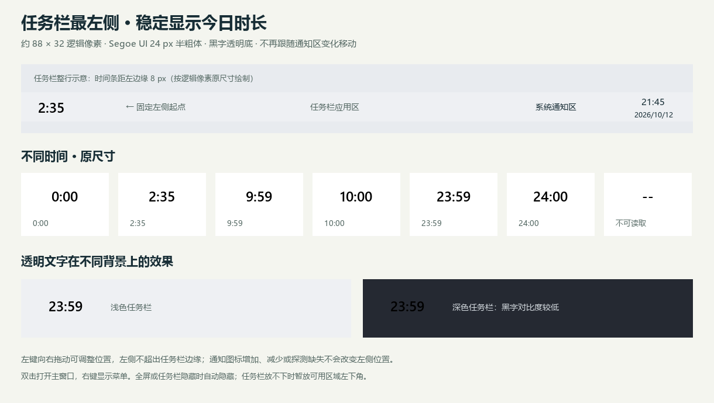

# 时光计 1.0.7

Windows 10 1809 及以上 / Windows 11（64 位）本地桌面应用，用来了解每天电脑运行了多久、时间花在哪些软件上。采用 Python + Qt（PySide6）原生窗口，SQLite 保存记录，无需账号或联网。

[下载 Windows 版](https://github.com/fly233li/shiguang/releases/latest) · [版本记录](https://github.com/fly233li/shiguang/releases)



## 直接使用

1. 解压 `时光计-1.0.7-Windows-x64.zip`，将整个 `Shiguang` 文件夹放在固定位置。
2. 双击文件夹内的 **Shiguang.exe**。不需要安装 Python，不需要管理员权限。
3. 首次启动后开始记录。在 **设置** 中可开启“登录 Windows 时启动，并留在托盘”，以覆盖日常使用时间。
4. 默认点击窗口右上角关闭按钮只收起窗口，仍会继续记录。点击系统托盘图标重新打开；右键选择“退出并停止记录”才完全退出。

**不要单独移动 Shiguang.exe，必须保留同目录 `_internal` 文件夹。** 若开启过自启，之后移动整个程序文件夹，请重新打开新位置的程序，并关闭、重新开启自启设置，让启动路径更新。

本构建未使用商业代码签名证书。系统可能显示未知发布者。开机启动默认关闭，由你在设置中选择。

从旧版本升级：先从系统托盘选择“退出并停止记录”，再把新版 `Shiguang` 文件夹中的文件完整覆盖到原程序文件夹，最后启动新版。两版使用同一个本地数据目录，已有记录会保留。也可以把新版放到其他目录；若启用了登录启动且移动了程序位置，请在新版设置中重新启用，以更新程序路径。

1.0.7 将时间条固定到主任务栏最左侧，默认距离左边缘 8 个逻辑像素。右侧托盘图标增减、通知区宽度变化或暂时无法读取通知区时，都不会改变时间条的位置。升级后从左侧默认位置开始，旧版右侧位置偏移不再沿用；之后的左侧微调位置会单独保存。

1.0.6 增加加宽透明时间条，默认宽 88 个逻辑像素，使用正常比例的 24 px 黑色数字。支持拖动调整位置，双击打开主窗口，右键菜单。每秒刷新，午夜自动切换当天累计；原托盘状态图标保留为菜单入口。

1.0.5 将右下角托盘时长改为横向 `H:MM`，例如 `2:35` 表示 2 小时 35 分钟；使用黑色数字，背景完全透明。

1.0.4 增加任务栏右下角今日电脑使用时长。每秒读取已保存的当天时长，满一分钟后更新数字；每天本地时间 0 点自动切换到新一天，历史记录保留。主窗口收起、浏览历史日期时也会继续刷新。

1.0.3 增加升级前完整备份、数据库结构与完整性校验、设置页手动备份入口。数据库与程序目录分离，版本切换时先备份，再保存新版本信息；备份失败或数据库不兼容时停止启动，保留原文件。

1.0.2 新增统一的原创图标系统：时钟环与光点构成主图标，28 枚圆角线条图标用于导航和功能；托盘以时钟、暂停、月亮、感叹号分别表示记录、暂停、离开或锁屏、异常。保留 1.0.1 的卡片网格、标题基线、控件高度及数字列对齐；计时逻辑与数据格式保持兼容。

## 页面与交互

| 页面 | 用途 |
| --- | --- |
| 今日概览 | 电脑运行、实际操作、离开/锁屏、使用软件数；24 小时时间分布；软件排行 |
| 软件统计 | 搜索应用名称或路径；查看单日、截至所选日的 7/30 天排行；点击一行查看程序路径 |
| 历史趋势 | 最近 7/30 天曲线式柱状对比；每日明细；双击日期返回当天概览 |
| 设置 | 登录启动、关闭到托盘、任务栏时间条、离开阈值、立即备份、数据与备份文件夹、统计口径 |

- 顶部日期选择器统一驱动统计，不能选择未来日期。可点击左右箭头或日历选择历史日期。
- 如果正在查看今天，跨午夜会自动切到新的一天；查看历史日期时保持选择。
- 图表浅绿色表示电脑运行，深绿色表示实际操作。将鼠标移到柱子可查看具体时长。
- “暂停软件统计”只暂停前台软件归属，电脑运行时间仍计入“暂停”状态；重启程序后自动恢复软件统计。
- “导出 CSV”导出当前页面的日期范围。CSV 是按时间段拆分的详细记录，包含日期、状态、软件和秒数，用 Excel 可直接打开。
- `Ctrl+1` 至 `Ctrl+4` 切换四个页面。

## 任务栏左侧的今日时长

- 默认启用加宽时间条。例如横向 `2:35` 表示今天已记录 **2 小时 35 分钟**，`0:09` 表示 9 分钟。黑色大字、透明背景；鼠标停留可读完整中文时长和当前记录状态，右键菜单也显示今日累计。
- 时间条默认固定于主屏幕任务栏最左侧，距左边缘 8 个逻辑像素，宽 88 个逻辑像素，随 Windows 显示缩放适配。位置独立于右侧通知区，图标增减不会带动时间条；仅在任务栏本身的位置或显示缩放变化时适配。它是独立透明窗口，不改变 Explorer 布局。
- 按住时间文字可左右拖动微调，松开后自动保存为相对任务栏左边缘的偏移；双击文字打开主窗口，右键选择“恢复任务栏最左侧”回到默认位置。如果以后启用左侧小组件或调整开始按钮对齐，可手动拖到空白处。
- 全屏应用或任务栏自动隐藏时，时间条会收起；返回桌面后恢复相同的左侧位置。无法读取任务栏本身位置时暂时隐藏并每秒重试；任务栏空间不足（例如窄的纵向任务栏）时，显示在屏幕可用区域左下角，悬停提示说明此位置。通知区信息缺失不会触发回退或移动。
- 显示的是“今日概览 → 电脑运行”，包含离开、锁屏及暂停软件统计期间的运行时间；休眠、关机、程序退出期间不计入。仅显示完整分钟，不提前四舍五入；重启软件会接着当天的历史累计。
- 每秒刷新，不依赖窗口是否显示，也不跟随页面中选中的历史日期。午夜只切换统计日期，不清空数据库；电脑从跨日休眠中恢复后也会切到当天。
- 设置中的“在任务栏左侧显示今日时长”可开启或关闭时间条。原有托盘图标继续显示记录状态；即使关闭时间条，悬停托盘图标及右键菜单仍可查看今日时长。统计读取失败显示 `--` 并提示不可读取，不把异常当成 0 分钟。
- Windows 可能把状态图标收进右下角的隐藏图标菜单。展开 `^`，把时光计图标拖到任务栏即可让菜单入口常显；时间条不受这个折叠设置影响。操作依据：[Microsoft 的任务栏说明](https://support.microsoft.com/en-us/windows/experience/personalization/customize-the-taskbar-in-windows)。

## 统计范围

**电脑运行**是记录器运行期间观察到的系统唤醒时间，包含实际操作、离开、锁屏、暂停和未识别时间；休眠、关机、记录器退出期间不计入。它不是整个 Windows 历史的追溯统计，首次启动之前的数据不会补造。

**实际操作**是电脑未锁屏、未达到离开阈值、可以识别前台应用时的时间。软件只按前台窗口分配，一个时刻最多记给一个应用；浏览器整体作为一个软件，后台运行、后台音乐不单独累加。

**离开**默认在 5 分钟没有键盘或鼠标输入之后开始计算，前 5 分钟仍归于此前的软件。观看视频或长时间阅读也可能被判定离开，可在设置中改为 1、3、5、10、15 或 30 分钟。

程序每秒采样，每 5 秒刷新可见页面统计，托盘每秒读取并更新今日时长，数据持续写入本地数据库。切换软件或锁屏存在约一个采样周期的边界误差。检测到休眠、系统时间跳变或超过 30 秒的采样中断时，跳过无法可靠归属的区间；因此更适合了解使用习惯，不是精确考勤工具。多次启动不会重复计时。

设置页另提供“系统本轮启动已经过去多久”，该数字包括休眠，和每日记录采用不同口径。快速启动等 Windows 行为也会影响这个参考数字。

## 数据与备份

默认目录：`%LOCALAPPDATA%\Shiguang`，可通过设置页打开。

该目录属于当前 Windows 用户，不在程序安装目录里，也不包含版本号。同一 Windows 账号下覆盖软件、更新版本或移动程序目录都会继续使用原来的记录。更新包不携带数据库，不会用空库覆盖你的历史。

- `usage.sqlite3`：使用记录和偏好。
- `usage.sqlite3-wal` / `usage.sqlite3-shm`：运行期间可能存在的数据库辅助文件。
- `app.log`：错误日志，自动轮换。
- `backups/`：完整 SQLite 备份，包含历史时段、软件统计所需信息和偏好设置。升级和手动备份均保留，不自动清理。

只记录应用名称、可执行文件路径、时间段和状态。不读取窗口标题、网页地址、键盘内容或屏幕图像，不上传记录。

**自动升级保护**：首次使用 1.0.3 打开已有记录，以及之后每次切换到不同的程序版本，都会先创建升级备份。使用 SQLite 一致性备份接口，已提交到 WAL 的记录也会包含在内；备份通过完整性检查后才保存版本信息。同一版本再次启动不会重复生成升级备份。新用户没有历史时直接初始化。

**手动备份**：在“设置 → 数据保护”点击“立即备份”，无需退出程序。界面会显示备份结果及最近备份，并可打开备份文件夹。备份文件可单独复制到其他硬盘用于迁移或另行保存。CSV 是统计导出，不能代替完整数据库备份。

**异常时的处理**：损坏、未知结构、更高版本的数据库和升级备份失败都会中止启动，不会删除数据库或自动改为空库。存在备份但主库缺失时也会提示恢复，避免误以为历史已清空。

**需要手动恢复时**（正常升级无需操作）：

1. 从托盘完全退出所有时光计窗口和进程，打开数据目录。
2. 新建一个保留原件的子文件夹，将现有的 `usage.sqlite3`、`usage.sqlite3-wal`、`usage.sqlite3-shm`（若存在）全部移入，避免遗留的 WAL 影响恢复。
3. 从 `backups/` 选择所需的完整 `.sqlite3` 备份，复制到数据目录并命名为 `usage.sqlite3`，原备份保留。
4. 使用兼容该备份的新版本启动。恢复后的记录截止到所选备份时间；原件中较新的记录仍保留在第 2 步的子文件夹，程序不会自动合并。

迁移电脑或更换 Windows 账号时，先完全退出应用，再复制整个数据文件夹到新账号的对应位置。只替换程序无需移动数据。卸载只需退出并关闭自启设置，再移除程序文件夹；是否保留历史数据由你决定。

## 源码运行与构建

需要 Windows x64 和 Python 3.13。当前构建使用 PySide6-Essentials 6.12.0、PyInstaller 6.22.3。

```powershell
python -m venv .venv
.\.venv\Scripts\python.exe -m pip install -r requirements-dev.txt
.\.venv\Scripts\python.exe main.py
```

```powershell
# 独立演示数据库，退出后删除，不污染真实记录
.\.venv\Scripts\python.exe main.py --demo

# 单元测试与 GUI 自动测试
.\.venv\Scripts\python.exe -m unittest discover -s tests -v

# 生成 dist\1.0.7\Shiguang\Shiguang.exe
.\build.ps1

# 真实旧版 EXE → 同目录覆盖新版 → 历史保留与继续计时验收（隔离数据）
.\.venv\Scripts\python.exe tools\verify_upgrade.py --old-dist dist\1.0.6\Shiguang --old-version 1.0.6
```

开发测试参数 `--data-dir 路径` 可指定隔离数据库；`--quit-after 毫秒` 定时退出；`--screenshot 路径` 保存当前窗口。截图仅属于显式开发参数，正常使用没有截屏逻辑。不要将开发测试参数放入日常自启项。

文件结构：`timelight/win32.py` 系统接口，`tracking.py` 计时判定，`storage.py` 数据库与版本兼容，`data_protection.py` 一致性备份，`ui.py` 页面与交互，`widgets.py` 图表控件，`icons.py` 原创矢量图标，`tray_clock.py` 分钟计数与旧版托盘像素字形，`taskbar_clock.py` 加宽透明时间条，`taskbar_native.py` 只读任务栏定位；`tests/` 覆盖时间边界、存储、升级保护、真实 Win32 接口和 GUI。后续开发必须遵守随附的 `AGENTS.md` 数据兼容约定。

图标源文件和设计总览位于 `assets/icons/`，包含三种配色的 SVG、透明 PNG 和多分辨率 ICO。运行 `tools/icon_board.py` 生成总览与小尺寸样张，运行 `tools/make_icon.py` 重新导出并校验资源，生成 `release/时光计-图标资源包.zip`。

技术口径依据：[Windows Interrupt Time](https://learn.microsoft.com/en-us/windows/win32/sysinfo/interrupt-time)、[GetLastInputInfo](https://learn.microsoft.com/en-us/windows/win32/api/winuser/nf-winuser-getlastinputinfo)、[Qt 系统托盘](https://doc.qt.io/qtforpython-6/PySide6/QtWidgets/QSystemTrayIcon.html)。第三方声明见 `THIRD_PARTY_NOTICES.md` 与 `licenses/`。
